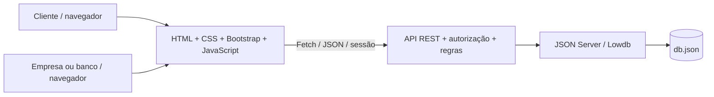

# 🏷️ Velora — Sistema de Aluguel de Carros


> Alugue com clareza. Gerencie clientes, pedidos, análises financeiras e contratos em um único protótipo web.

Projeto do **Laboratório 02 de Desenvolvimento de Interfaces Web (DIW)**, conforme o enunciado “Sistema de Aluguel de Carros”. O README adapta as seções do [template do professor João Paulo Aramuni](https://github.com/joaopauloaramuni/desenvolvimento-de-interfaces-web/blob/main/TEMPLATES/template_README.md).
## 🚧 Status do Projeto

Protótipo acadêmico executável localmente. A interface e a API utilizam as tecnologias exigidas; os modelos iniciais e revisados acompanham o código. Pagamentos, consultas de crédito, assinatura digital e financiamento bancário reais não são realizados. Todos os dados de demonstração são fictícios.

## 📚 Índice

- [Links úteis](#-links-úteis)
- [Sobre o projeto](#-sobre-o-projeto)
- [Funcionalidades principais](#-funcionalidades-principais)
- [Tecnologias utilizadas](#-tecnologias-utilizadas)
- [Arquitetura](#-arquitetura)
- [Instalação e execução](#-instalação-e-execução)
- [Deploy](#-deploy)
- [Estrutura de pastas](#-estrutura-de-pastas)
- [Demonstração](#-demonstração)
- [Testes](#-testes)
- [Documentações utilizadas](#-documentações-utilizadas)
- [Autores](#-autores)
- [Contribuição](#-contribuição)
- [Agradecimentos](#-agradecimentos)
- [Licença](#-licença)

## 🔗 Links Úteis

- Aplicação local: <http://localhost:3000> após iniciar o servidor.
- [Modelos UML: índice visual e fontes](docs/modelos/index.html).
- [Requisitos, histórias e rastreabilidade](docs/requisitos.md).
- [API REST e regras de negócio](docs/api.md).
- [Arquitetura e decisões](docs/arquitetura.md).
- [Evolução dos modelos](docs/modelos/REVISOES.md).
- [Testes manuais](docs/testes-manuais.md).
- [Resultados e limites da validação](docs/validacao.md).

## 📝 Sobre o Projeto

A Velora centraliza o aluguel de automóveis: o cliente se cadastra, escolhe um carro e solicita um período; uma empresa ou banco avalia o pedido financeiramente e, após aprovação, formaliza o contrato. Cada perfil possui ações e acesso aos dados compatíveis com seu papel.

A solução aplica a separação sugerida no enunciado: um subsistema constrói dinamicamente as páginas no navegador e outro gerencia pedidos e contratos no servidor central. O JSON Server persiste os dados no arquivo `db.json`, consumido pela interface usando Fetch API. A documentação relaciona os requisitos, os modelos UML e a implementação.

## ✨ Funcionalidades Principais

- Cadastro e login, com três perfis: cliente, empresa e banco.
- CRUD de clientes com RG, CPF, nome, endereço, profissão e até três entidades empregadoras com seus rendimentos.
- Catálogo de automóveis com matrícula, ano, marca, modelo, placa e diária.
- Criação, consulta, edição e cancelamento de pedidos de aluguel; histórico de alterações e acompanhamento de status.
- Análise financeira por agentes com parecer registrado e atualização de pedidos.
- Contratação somente após aprovação; identificação de propriedade por cliente, empresa ou banco.
- Crédito opcional concedido por banco agente e associado ao contrato de aluguel.
- Verificação de conflitos de período para reservas aprovadas ou contratadas.
- Interface responsiva, formulários validados, mensagens de erro e dados persistentes.

## 🛠 Tecnologias Utilizadas

### 💻 Front-end

| Tecnologia | Uso |
| --- | --- |
| HTML5 | Estrutura semântica das páginas |
| CSS3 | Identidade visual e responsividade |
| JavaScript | Navegação, formulários e renderização dinâmica |
| Bootstrap 5 | Interface e componentes, com arquivos distribuídos localmente |
| Fetch API | Comunicação HTTP com a API REST |

### 🖥️ Back-end

| Tecnologia | Uso |
| --- | --- |
| Node.js 20 ou superior | Execução do servidor |
| JSON Server 0.17.4 | API simulada e persistência com Lowdb em `db.json` |
| Middlewares JavaScript | Validação, sessões, permissões e regras de domínio |
| Node Crypto | Hash de senhas; os valores de senha não são retornados pela API |
| Node Test Runner | Testes automatizados de integração |

### ⚙️ Infraestrutura & DevOps

Execução em um único processo local, sem compilação e sem banco externo. O `package-lock.json` fixa as dependências. O workflow `.github/workflows/ci.yml` executa verificação e testes no GitHub Actions quando este projeto for publicado. A publicação no GitHub é uma etapa de entrega a ser realizada na conta do aluno; este pacote não afirma possuir um repositório remoto publicado.

## 🏗 Arquitetura



O frontend e a API compartilham a mesma origem. As rotas da API verificam a sessão e o papel do usuário antes de ler ou gravar dados. O arquivo de persistência e os hashes de senha não são servidos como arquivos públicos. A modelagem de classes representa entidades conceituais; na implementação JavaScript elas são documentos e funções, sem exigir classes ES6 artificiais.

### Exemplos de diagramas

| Modelo | Versão inicial | Versão revisada |
| --- | --- | --- |
| Casos de uso | [v1](docs/modelos/v1/casos-de-uso.puml) | [v2](docs/modelos/v2/casos-de-uso.svg) · [fonte](docs/modelos/v2/casos-de-uso.puml) |
| Classes | [v1](docs/modelos/v1/classes.puml) | [v2](docs/modelos/v2/classes.svg) · [fonte](docs/modelos/v2/classes.puml) |
| Pacotes / visão lógica | [v1](docs/modelos/v1/pacotes.puml) | [v2](docs/modelos/v2/pacotes.svg) · [fonte](docs/modelos/v2/pacotes.puml) |
| Componentes | [v1](docs/modelos/v1/componentes.puml) | [v2](docs/modelos/v2/componentes.svg) · [fonte](docs/modelos/v2/componentes.puml) |

Veja [as decisões e limites](docs/arquitetura.md) e [o que mudou entre os modelos](docs/modelos/REVISOES.md). Não foram fornecidos modelos anteriores da turma ou feedbacks do professor: v1 é a primeira interpretação do enunciado e v2 documenta a solução deste pacote.

## 🔧 Instalação e Execução

### Pré-requisitos

- **Node.js 20 ou superior**, disponível em <https://nodejs.org>.
- npm (incluído com Node.js).
- Navegador atualizado: Chrome, Edge, Firefox ou Safari.
- Internet apenas para instalar as dependências; os recursos da interface são locais.

### 🔑 Variáveis de Ambiente

Não é necessário configurar variáveis para o teste local. A porta padrão é `3000`. Para mudar a porta em Linux/macOS: `PORT=3001 npm start`. No PowerShell: `$env:PORT=3001; npm start`.

### 📦 Instalação de Dependências

Extraia o ZIP e abra um terminal na pasta `velora`, onde está o `package.json`:

```bash
npm install
```

Com o lockfile incluído, também é possível instalar de forma reproduzível com `npm ci`.

### 💾 Inicialização do Banco de Dados

O pacote inclui `db.json` preenchido com usuários e automóveis de demonstração. Os dados são gravados nesse arquivo a cada operação; encerrar e reiniciar o servidor preserva as alterações. Não é necessário instalar PostgreSQL ou outro servidor de banco de dados.

Para restaurar os dados fictícios, pare o servidor e execute `npm run reset`. O script cria automaticamente um backup `db.json.backup-TIMESTAMP` antes de substituir o banco. A restauração substitui os cadastros e pedidos locais e renova as datas dos exemplos; reinicie o servidor depois. Para preservar suas alterações, guarde o backup.

### ▶️ Como Executar a Aplicação

```bash
npm start
```

Alternativa: no Windows, abra `iniciar.bat`; no Linux/macOS, execute `bash iniciar.sh`. Os atalhos instalam dependências quando necessário.

Abra **<http://localhost:3000>**. Mantenha o terminal aberto durante os testes. Para encerrar, pressione `Ctrl+C`. Abrir o arquivo `index.html` diretamente ou usar apenas o Live Server não inicia a API.

| Perfil | E-mail | Senha |
| --- | --- | --- |
| Cliente | `cliente@velora.com` | `Demo@123` |
| Empresa | `empresa@velora.com` | `Demo@123` |
| Banco | `banco@velora.com` | `Demo@123` |

Use as contas acima para testar os perfis ou crie um cliente pela tela de cadastro. Os agentes são previamente cadastrados no banco de demonstração; o cadastro público não concede privilégios de empresa ou banco.

## 🚀 Deploy

A entrega foi preparada para execução local com Node.js e JSON Server. Uma hospedagem apenas estática, como GitHub Pages, não executa a API nem persiste `db.json`. Para uma demonstração remota seria necessário um processo Node ativo e disco persistente. O protótipo precisa de endurecimento de segurança, política de proteção de dados e infraestrutura apropriada antes de uso real.

Para a entrega acadêmica, crie um repositório na sua conta e publique **código e as duas versões dos modelos**. Antes de publicar, substitua os dados fictícios que tiver alterado e confira se não há dados pessoais reais. Exemplo, a partir da pasta do projeto:

```bash
git init
git add .
git commit -m "feat: adiciona protótipo Velora e modelagem UML"
git branch -M main
git remote add origin URL_DO_REPOSITORIO_CRIADO_NA_SUA_CONTA
git push -u origin main
```

O marcador `URL_DO_REPOSITORIO_CRIADO_NA_SUA_CONTA` deve ser substituído pelo endereço real. O pacote inclui um registro documental das revisões; ele não simula commits históricos ou feedbacks de aula.

## 📂 Estrutura de Pastas

```text
velora/
├── README.md
├── package.json / package-lock.json
├── server.cjs                 # API, sessão, regras e arquivos estáticos
├── db.json                    # Dados locais mutáveis
├── seed-db.json               # Base de demonstração
├── scripts/seed.cjs           # Preparação/restauração de dados
├── public/                    # HTML, estilos, JS, Bootstrap e imagens
├── tests/                     # Testes automatizados
└── docs/
    ├── requisitos.md          # Histórias, critérios e rastreabilidade
    ├── arquitetura.md         # Subsistemas e decisões
    ├── api.md                 # Contrato HTTP e regras
    ├── testes-manuais.md      # Roteiro de verificação
    └── modelos/
        ├── index.html        # Visualização offline dos diagramas finais
        ├── REVISOES.md
        ├── v1/*.{puml,svg}    # Primeira modelagem e imagens
        └── v2/*.{puml,svg}    # Modelagem revisada e imagens
```

## 🎥 Demonstração

### 🌐 Aplicação Web

1. Entre como cliente e explore o catálogo.
2. Selecione um veículo, informe um período futuro e crie um pedido.
3. Consulte o status do pedido; edite-o antes da aprovação.
4. Saia e entre como empresa para registrar a análise financeira.
5. Após aprovação, formalize um contrato com o proprietário correspondente.
6. Repita com a conta do banco para associar um contrato de crédito.

Veja o [roteiro de testes](docs/testes-manuais.md). O sistema é uma aplicação web responsiva; não há aplicativo mobile nativo.

### 💻 Exemplo de Saída no Terminal (API)

```bash
curl -X POST http://localhost:3000/api/auth/login \
  -H "Content-Type: application/json" \
  -d '{"email":"cliente@velora.com","password":"Demo@123"}'
```

A resposta contém `token` e `user`. Use o token em `Authorization: Bearer SEU_TOKEN` para consultar `/api/requests`. A [documentação da API](docs/api.md) descreve as demais operações. O token é uma sessão do protótipo, não um JWT.

## 🧪 Testes

### Testes de Integração

Na validação desta entrega: **14 testes aprovados, sem falhas**. Veja [o registro e os limites da verificação](docs/validacao.md).

```bash
npm test
```

Os testes usam o runner nativo do Node, JSDOM para os fluxos da interface, uma instância isolada da API e um arquivo temporário de dados. O objetivo é verificar autenticação, permissões, persistência e transições de pedidos sem alterar o `db.json` utilizado na demonstração. Consulte os arquivos em `tests/` para os cenários efetivamente automatizados.

### Testes de interface

A suíte `npm test` também executa os formulários reais com JSDOM, Bootstrap e Fetch contra uma API isolada: criação de pedido, contrato com crédito e cadastro/edição/exclusão de cliente. Essa verificação de DOM não substitui a revisão visual em navegador.

Siga [os cenários manuais com resultado esperado](docs/testes-manuais.md), incluindo cadastro, limite de três rendas, permissões, cancelamento, aprovação, contrato e crédito. Não há comando fictício `test:e2e`; somente os scripts realmente incluídos no `package.json` devem ser usados.

## 🔗 Documentações utilizadas

- [Bootstrap 5](https://getbootstrap.com/docs/5.3/getting-started/introduction/).
- [JSON Server 0.17.4](https://github.com/typicode/json-server/tree/v0.17.4).
- [Fetch API — MDN](https://developer.mozilla.org/pt-BR/docs/Web/API/Fetch_API).
- [HTML — MDN](https://developer.mozilla.org/pt-BR/docs/Web/HTML).
- [Node.js Test Runner](https://nodejs.org/api/test.html).
- [PlantUML](https://plantuml.com/): sintaxe dos diagramas incluídos.
- [Material da disciplina e template](https://github.com/joaopauloaramuni/desenvolvimento-de-interfaces-web).

## 👥 Autores

**Responsável acadêmico:** Arthur Rodrigues Miranda — matrícula 918438. **Disciplina:** DIW — Engenharia de Software. **Professor:** João Paulo Carneiro Aramuni.

## 🤝 Contribuição

Crie uma branch, implemente a alteração, execute os testes e atualize os modelos se o domínio ou a arquitetura mudar. Abra um pull request descrevendo o requisito atendido e a validação. Preserve as versões anteriores dos diagramas para permitir a comparação exigida no laboratório.

## 🙏 Agradecimentos

Ao professor João Paulo Aramuni pelo enunciado, material e template de documentação. Às comunidades de Bootstrap, JSON Server, Node.js e MDN pelas ferramentas e referências.

## 📄 Licença

Este pacote é uma entrega acadêmica. O titular do trabalho deverá definir a licença de distribuição do código autoral antes de publicação aberta. Bootstrap e demais dependências mantêm suas próprias licenças; os créditos de terceiros devem ser preservados. Não se atribui uma licença MIT ao trabalho sem decisão do autor.


