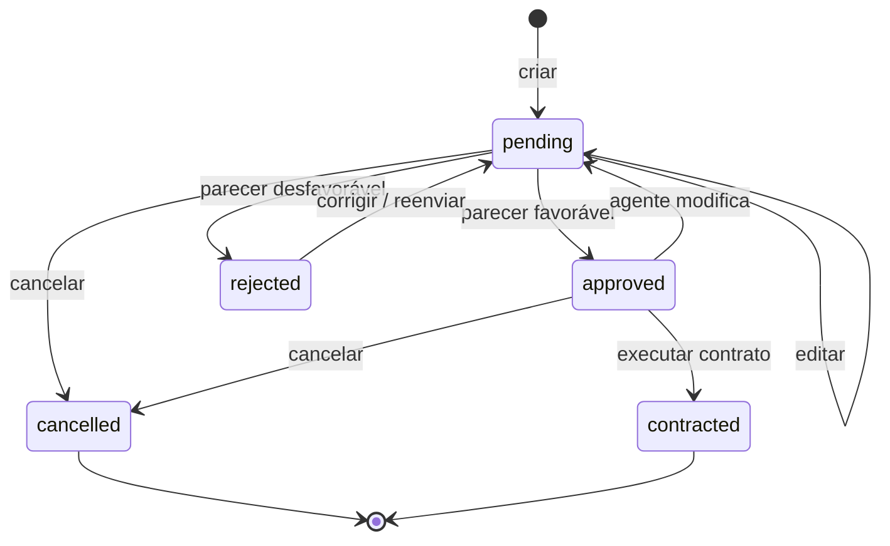

# API REST

Base local: `http://localhost:3000/api`. As requisições com corpo usam `Content-Type: application/json`. Após login/cadastro, envie `Authorization: Bearer TOKEN`. A resposta de autenticação tem a forma `{ "token": "...", "user": { ... } }`.

O servidor é construído sobre JSON Server 0.17.4 e sua persistência Lowdb. As rotas de domínio adicionam autorização e regras antes de manipular os documentos em `db.json`; a interface usa Fetch API. O CRUD genérico sem proteção de JSON Server não é exposto para contornar as regras.

## Autenticação

| Método e caminho | Entrada / saída | Acesso |
| --- | --- | --- |
| `POST /auth/register` | Nome, e-mail, senha, CPF, RG, endereço, profissão, `employers`; retorna token/usuário | Público; cria somente cliente |
| `POST /auth/login` | `{email,password}`; retorna token/usuário | Público |
| `GET /auth/me` | Usuário autenticado, sem hash de senha | Sessão |
| `POST /auth/logout` | Invalida a sessão | Sessão |

Sessões bearer são mantidas na memória do processo com duração de oito horas. Reiniciar o servidor invalida sessões, mas mantém os dados. As senhas são armazenadas como hash derivado com salt; o frontend nunca recebe esse hash.

## Clientes, agentes e automóveis

| Método e caminho | Operação | Autorização |
| --- | --- | --- |
| `GET /clients` | Lista clientes visíveis | Cliente: próprio cadastro; agente: todos |
| `GET /clients/:id` | Consulta cliente | Próprio cliente ou agente |
| `POST /clients` | Cria cliente com conta | Agentes |
| `PATCH /clients/:id` | Atualiza cadastro | Próprio cliente ou agente |
| `DELETE /clients/:id` | Exclui cliente sem pedidos/contratos | Próprio cliente ou agente |
| `GET /agents` | Lista id, nome e tipo dos agentes | Sessão |
| `GET /cars` | Catálogo de veículos | Sessão |

Campos de cliente: `id`, `role`, `name`, `email`, `cpf`, `rg`, `address`, `profession`, `employers: [{name,income}]`. O cadastro também exige `password`. A coleção persistente é `users`; `clients` é a visão protegida dos documentos com `role=client`. Não há duplicação de cliente e usuário com informações divergentes.

Campos de automóvel: `id`, `registration`, `year`, `brand`, `model`, `plate`, `category`, `transmission`, `fuel`, `seats`, `dailyRate`, `color`, `ownerType`, `ownerId`. O catálogo é pré-cadastrado porque CRUD de frota não é exigido no laboratório.

## Pedidos

| Método e caminho | Operação | Autorização |
| --- | --- | --- |
| `GET /requests` | Lista pedidos visíveis | Cliente: próprios; agente: todos |
| `GET /requests/:id` | Detalhe de pedido | Proprietário ou agente |
| `POST /requests` | Cria pedido | Cliente |
| `PATCH /requests/:id` | Modifica pedido | Proprietário/estado permitido ou agente |
| `POST /requests/:id/cancel` | Cancela sem apagar | Próprio cliente; estado pendente ou aprovado |
| `POST /requests/:id/review` | Registra parecer financeiro | Empresa ou banco |
| `POST /requests/:id/contract` | Executa contrato | Empresa ou banco, após aprovação |

Entrada de criação/edição:

```json
{
  "carId": "ID_DO_CARRO",
  "startDate": "2027-02-10",
  "endDate": "2027-02-13",
  "notes": "Retirada pela manhã.",
  "creditRequested": false
}
```

Use datas futuras no teste. O exemplo representa três diárias. `clientId` vem da sessão; `days`, `total` e `status` são calculados no servidor. IDs concretos devem ser obtidos do catálogo/da resposta, não copiados de exemplos.

Parecer:

```json
{"decision":"approved","notes":"Rendimentos e período analisados; parecer favorável."}
```

`decision` aceita `approved` ou `rejected`; a justificativa é obrigatória. O histórico inclui momento, ação, ator e nota. A edição de um pedido retorna seu estado a `pending` para evitar reutilizar uma aprovação anterior a mudanças financeiras.

## Estados de pedido



A API verifica sobreposição com pedidos aprovados/contratados ao criar, editar, aprovar ou contratar. Aprovações de dois pedidos pendentes concorrentes não podem reservar o mesmo carro simultaneamente. Intervalos adjacentes são permitidos porque `endDate` é exclusiva.

## Contratos e crédito

| Método e caminho | Operação | Autorização |
| --- | --- | --- |
| `GET /contracts` | Lista contratos visíveis | Cliente: próprios; agente: todos |
| `GET /contracts/:id` | Consulta contrato | Próprio cliente ou agente |

Criação sem crédito, por uma empresa ou banco:

```json
{"ownerType":"company","ownerId":"ID_DA_EMPRESA"}
```

Tipos de proprietário: `client`, `company` e `bank`. A referência precisa existir e ser compatível com o tipo. A titularidade contratual é registrada junto ao automóvel conforme a modalidade escolhida.

Criação com crédito, pelo próprio banco concedente:

```json
{
  "ownerType":"bank",
  "ownerId":"ID_DO_BANCO_LOGADO",
  "credit":{"bankId":"ID_DO_BANCO_LOGADO","installments":12,"interestRate":1.5}
}
```

O crédito é opcional; empresa e cliente não podem concedê-lo. Quando o cliente marca `creditRequested=true`, o contrato exige crédito emitido por banco. O banco deve ser o próprio usuário autenticado. São aceitas de 1 a 60 parcelas e taxa mensal de 0% a 20%.

A simulação calcula parcelas fixas pela fórmula Price: `parcela = principal × i / (1 − (1 + i)^(-n))`, em que `i` é a taxa mensal dividida por 100 e `n` o número de parcelas. Com taxa zero, divide o principal por `n`. A parcela é arredondada para centavos; o total financiado é a parcela arredondada multiplicada por `n`. A diferença de arredondamento deve ser considerada ao comparar com um sistema financeiro real.

As condições são demonstrativas, sem consulta a instituições financeiras, desembolso ou validade contratual presumida. A resposta do contrato inclui pedido, cliente, automóvel, período, total, titularidade e o crédito com `principal`, `installmentAmount` e `totalFinanced`, quando houver. O proprietário do tipo cliente deve ser o cliente do próprio pedido.

## Códigos HTTP

| Código | Significado |
| --- | --- |
| `200` / `201` | Consulta/alteração bem-sucedida ou recurso criado |
| `400` | Entrada inválida, datas, CPF, rendas ou condições de crédito inválidas |
| `401` | Sem sessão válida ou credenciais incorretas |
| `403` | Perfil ou proprietário do recurso sem permissão |
| `404` | Recurso não encontrado |
| `409` | Conflito de cadastro, estado, referência ou período |

O corpo de erro inclui uma mensagem legível. O cliente deve verificar `response.ok` antes de tratar a operação como sucesso. Nunca use a resposta de autenticação como base para conceder privilégios apenas no navegador: o servidor também valida toda ação.
